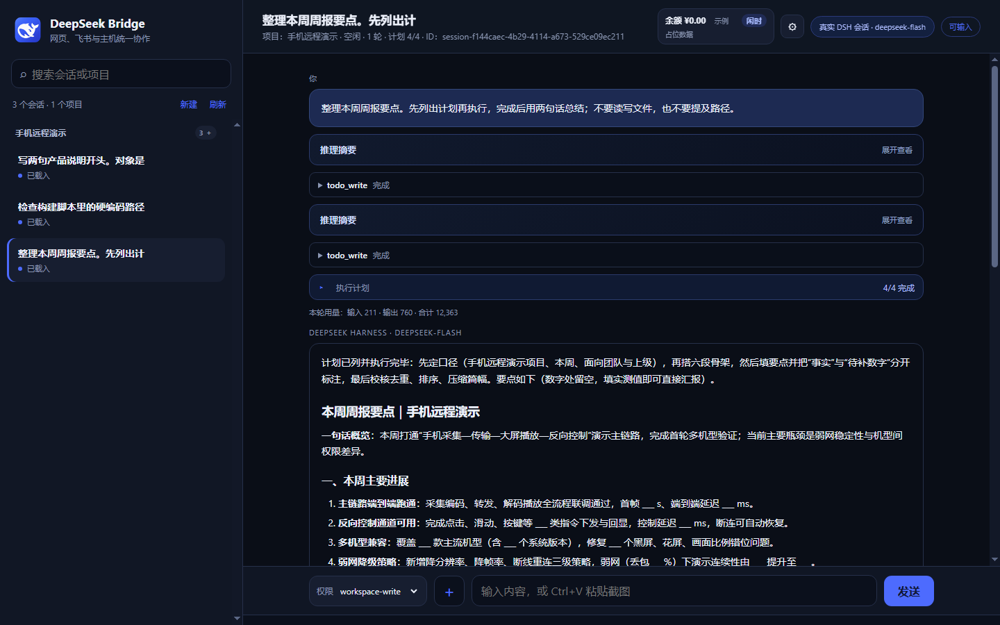
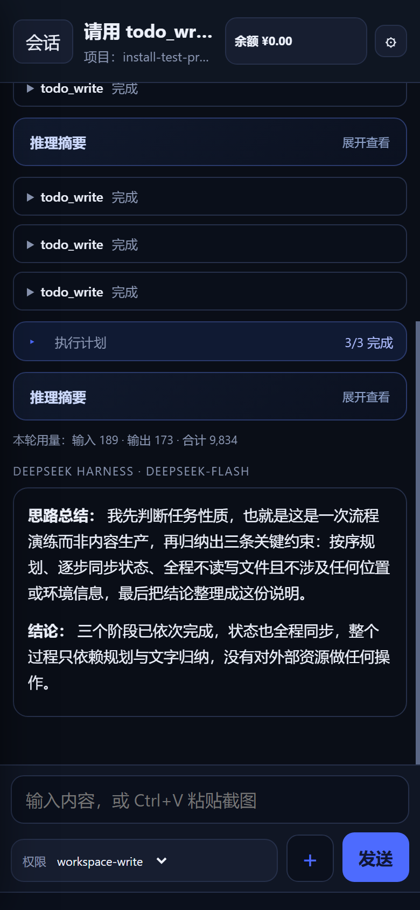

# DeepSeek Remote Bridge

> 手机、平板或另一台电脑打开网页，就能用你主力电脑上的 **DeepSeek Harness** 干活：
> 真实会话、真实工具、真实批准，右上角是**原生账户余额**。

**v1.8.0** · 作者 [xiyannan](https://github.com/dizzynote-cell) · MIT · 未部署、无服务器依赖、仓库内不含任何密钥



<p align="center"></p>

<sub>截图来自一个隔离的演示实例：会话内容为演示数据，余额用占位数字代替。</sub>

---

## 它解决什么问题

DeepSeek Harness 很强，但它只在你自己的电脑上。离开电脑时：

- 想让它在项目里改个文件、跑个命令 —— 没入口；
- 它卡在"需要批准"上 —— 你看不到；
- 想知道它做到哪一步了 —— 只能回去看屏幕。

这个桥把**同一个运行时**暴露成一个网页：代码、终端、文件操作仍然在主力电脑上执行，
手机只负责输入和查看。**不是云服务，不需要公网服务器，也不会上传你的会话。**

## 核心亮点

- **真会话，不是聊天 API 演示**：通过官方 SDK 协议（`session/prompt`、`session/resume`、
  `session/wait`、`session.event`）驱动本机运行时，历史、工具执行、终态都来自 Harness 自己。
- **手机优先**：响应式布局、可"添加到主屏幕"（PWA）、通知区域托盘图标、深色界面。
- **工具齐全**：模型可见 28 个工具（桌面端 32 个），含 `pwsh`、文件读写、搜索、网页、技能、
  子代理、工作流、计划（todo）、`present`、`load_workspace_dependencies`。
- **批准与提问能回到手机**：工具要授权、模型要提问时，网页里出现待处理卡片，点一下就把决定送回原请求。
- **执行计划与实时进度**：模型用 `todo_write` 拆步骤时，网页显示 3/3 完成、当前在跑哪个工具、用了多久。
- **模型与强度可选**：输入框上方一行可以切 `V4.1-Flash` / `V4-Pro` 和 `off/low/high/max`，
  切换会重启该会话的运行时并保留全部历史；新会话默认值也可单独设置。
- **权限可控**：同一行里的「权限」菜单（工作区写入 / 完全访问），可以给单个会话切换，
  也可以在设置里定"新会话默认权限"。
- **原生余额**：右上角是 DeepSeek 账户的真实钱包（充值/赠送分开、多币种不加总），失败就显示"暂不可用"，不会显示 0。
- **闲时/忙时徽标**：余额旁边显示当前计费时段与距下次切换的倒计时（工作日 09:00–12:00、14:00–18:00 为高峰，其余与周末为闲时）。
- **可选语音**：完成的回复可以点一下朗读，TTS 只在主机上合成，密钥不进浏览器。

## 安装前准备

1. Windows 10/11（本机在 Windows 10 22H2 验证）
2. Python 3.10+（只需标准库，无第三方依赖）
3. 已安装并登录 **DeepSeek Harness 桌面版**（本机验证 `0.2.1-rc.2`）
4. 知道它的安装位置，例如 `C:\Program Files\DSH\DeepSeek Harness.exe`
5. 端口 8766 空闲（Codex 桥用的是 8765/8780，不会冲突）

## 安装（约 2 分钟）

```powershell
git clone https://github.com/dizzynote-cell/deepseek-remote-bridge.git
cd deepseek-remote-bridge
powershell -NoProfile -ExecutionPolicy Bypass -File .\install.ps1
```

向导会做六件事：检查 Python → 自动找到（或询问）Harness 安装路径 → 选端口 →
建工作目录 → 选默认权限（可选配语音）→ 写 `config/.env`、启动桥、可选开机自启。

不想交互也可以：

```powershell
.\install.ps1 -Unattended -Port 8766 `
  -ProjectsRoot "$env:USERPROFILE\DSH-Bridge\projects" `
  -Preset workspace-write -NoAutostart
```

重新配置用 `-Force`（会保留一份 `config/.env.bak`）。

## 启动与运行

```powershell
python bridge.py                 # 前台运行，Ctrl+C 停止
.\scripts\start-bridge.ps1       # 后台启动并等健康检查
.\scripts\status-bridge.ps1      # PID / 地址 / 健康 / 托盘状态
.\scripts\stop-bridge.ps1        # 只停 state/bridge.pid 里那个进程
.\scripts\restart-bridge.ps1
.\scripts\install-shortcuts.ps1  # 桌面快捷方式 + 登录启动项（-Remove 取消）
.\scripts\install-watchdog.ps1   # 自动恢复任务：每 3 分钟检查一次（-Remove 取消）
```

### 挂了会自动回来

桥是一个普通进程，可能被关掉、被杀掉或崩溃。`install-watchdog.ps1` 注册一个**计划任务**：
登录时跑一次，之后每 3 分钟跑一次；健康检查失败或进程不在，就把它重新拉起来（并补上托盘）。
实测：手动停掉桥，任务运行后 5 秒内恢复，页面重新可访问。

- 想主动停桥维护时，先 `install-watchdog.ps1 -Remove`，否则 3 分钟内会被拉起来。
- 任务只认本仓库 `state/bridge.pid` 记录的进程，不会碰 Codex 桥。

双击 `DeepSeek Remote Bridge.cmd` 会启动桥 + 托盘并打开页面。

### 桌面快捷方式与开机启动

```powershell
.\scripts\install-shortcuts.ps1 -Desktop -Startup   # 建桌面快捷方式 + 开机启动
.\scripts\install-shortcuts.ps1 -Remove             # 两个都删掉
```

- 桌面快捷方式叫 **DeepSeek Remote Bridge**，图标与页面左上角一致（`assets/bridge.ico`）；
  双击后隐藏窗口启动桥和托盘，再打开页面；已经在运行就只打开页面。
- 开机启动用的是当前用户的「启动」文件夹快捷方式（登录后运行），与你 Codex 桥的启动项互不影响。
- 安装向导最后会问一次，默认两个都建。

- 托盘是鲸鱼图标（`assets/bridge.ico`），右键可看状态、打开页面/日志、启动/停止/重启，双击打开页面。
- Windows 10 默认把新图标放进 `^` 溢出区：点 `^` 找到 D 拖到任务栏，或运行
  `.\scripts\show-tray-settings.ps1`。
- 启动脚本只按 `state/bridge.pid` 管理自己的进程，**不会碰同机的 Codex 桥**。

## 手机访问

| 场景 | 做法 |
|---|---|
| 同一台电脑 | `http://127.0.0.1:8766/` |
| 同一局域网 | 反代到本机端口，并加上访问控制（默认只监听回环） |
| 外网 | 用你自己的 HTTPS 隧道/反代到 `127.0.0.1:8766`，不要直接把端口暴露到公网 |
| 安装到桌面 | HTTPS（或 localhost）下用浏览器"添加到主屏幕"，获得全屏独立窗口 |

基址可配：`DSH_BRIDGE_BASE_PATH=/dsh/` 时所有资源、接口、下载都会跟着前缀走；
前缀之外的路径一律 404，不会串到同源的 Codex 桥。

> 登录/鉴权还没有实现。局域网或外网使用前请先加一层反代认证；
> 飞书 OAuth 登录的施工图在 [`docs/feishu-setup.md`](docs/feishu-setup.md)。

## 配置

全部写在 `config/.env`（进程环境变量优先）：

| 变量 | 默认 | 说明 |
|---|---|---|
| `DSH_EXE` / `DSH_CLI` | 自动探测 | Harness 可执行文件与 CLI 入口 |
| `DSH_HOME` | 空（用 Harness 默认） | 隔离测试时才需要 |
| `DSH_BRIDGE_HOST` / `DSH_BRIDGE_PORT` | `127.0.0.1` / `8766` | 监听地址与端口 |
| `DSH_BRIDGE_BASE_PATH` | `/` | 可挂 `/dsh/` |
| `DSH_BRIDGE_PROVIDER` / `DSH_BRIDGE_MODEL` | `deepseek-account` / `deepseek-flash` | 模型路由 |
| `DSH_BRIDGE_REASONING_EFFORT` | 空 | 如 `high` / `max`（桌面端默认 `max`） |
| `DSH_BRIDGE_PERMISSION_PRESET` | `workspace-write` | 新会话默认权限 |
| `DSH_BRIDGE_PROJECTS_ROOT` / `…_STANDALONE_DIR` | `~/DSH-Bridge/...` | 允许新建会话的目录白名单 |
| `DSH_BRIDGE_HOME` | `./state` | 令牌、补丁、日志、上传、缓存 |
| `DSH_BRIDGE_VOICE` / `VOLC_TTS_ENV_FILE` | `0` / 空 | 可选语音朗读 |
| `DSH_BRIDGE_ATTACHMENT_MAX_BYTES` / `…_BATCH_…` | 10 MB / 30 MB | 附件限制 |

## 用起来是什么样

- **发任务**：选会话直接输入；附件（图片/文档）随消息上传，图片内联给模型，文档落到桥目录并把路径写进提示。
- **看进度**：底部实时条显示「第 2 轮 · 正在运行 write · 已调用工具 2 次 · 计划 4/5 · 已用时 4 秒」。
- **接批准**：工具要授权时，"待处理"面板出现卡片；允许/拒绝/回答问题都按原请求回填。
- **取结果**：模型写出的文件出现在"返回的文件"，可预览、下载或在主机上打开。
- **换权限**：输入框上方切换本会话权限；设置里定新会话默认值。
- **听结果**：完成的回复可朗读（需配置 TTS）。
- **看时段**：点余额看详情，里面有当前时段、距切换时间与规则；高峰时段的价格表以官方为准，桥只提示时段。

## 不开桌面客户端能用吗

能。桥用安装包里的同一个运行时自己启动 `dsh --profile sdk` 进程，凭据与会话都来自同一个
`%USERPROFILE%\.dsh`；桌面窗口关掉也照常工作。实测工具覆盖 28/32，差的 4 个是
`schedule_*`（会话内定时提醒，需要桌面的会话控制器，SDK 组合里没有）。

仍需桌面的三件事：凭据过期后重新登录、桌面 profile 里的自定义 patch（如 MCP 服务器）不会继承、
桌面正在打开的会话被写锁占用时桥返回 `409`。

## 左上角切换：给入口页的接口

点左上角的 **D** 会打开后端菜单。当前项是 DeepSeek Harness；另一项默认置灰
（`disabled` + `aria-disabled="true"`），**不会给出无效跳转**。

合并到 Codex 工作台时，只要给 DSH 桥一个"兄弟桥"地址，菜单项就会变成可点的真实跳转：

```ini
DSH_BRIDGE_SIBLING_PROVIDER=codex
DSH_BRIDGE_SIBLING_NAME=Codex
DSH_BRIDGE_SIBLING_URL=https://<入口页域名>/
```

- 只接受 `http(s)` 绝对地址；空值或 `javascript:` / 相对路径一律保持禁用。
- 菜单数据来自 `GET /api/bridge-info` 的 `logoMenu.targets`，入口页也可以直接读这个接口自己渲染切换器。
- 切换是整页跳转，两个桥各自保存会话、草稿与附件待发区，互不迁移（见 [`docs/integration.md`](docs/integration.md)）。

## 隐私与安全

- 仓库里**没有**任何密钥、令牌、会话记录或本机绝对路径；`config/.env`、`state/`、`*.pem`、日志与上传目录都在 `.gitignore` 内。
- 桥只监听回环；写请求有同源检查；下载只允许工作区白名单内的文件。
- 适配器插件只在 `127.0.0.1` 的随机端口监听，每次启动随机令牌；浏览器永远拿不到 Harness 凭据。
- 不做遥测，不上传任何内容。

## 已知限制

- **没有取消运行中的任务、没有指定回合 steer、没有模型热切换**：官方 SDK 协议不提供，面板如实显示 `false`。
- **定时提醒（`schedule_*`）**不可用，原因见上。
- **只验证了 Windows**；语音只实测了火山 TTS。
- **凭据过期**需要回桌面端点一次登录。
- 没有任何登录体系，公网暴露前必须自己加一层认证。

## 开发与测试

```powershell
python tests\run_tests.py        # 131 个 Python 用例 + 2 个 Node 页面契约用例
```

真实联调（只创建自己的测试会话/目录）：`live_check.py`、`live_interactions.py`、
`live_attachments.py`、`live_ownership.py`、`live_parallel.py`、`live_files.py`、
`live_permissions.py`、`live_tools.py`。结果见 [`docs/verification.md`](docs/verification.md)。

文档：架构 [`docs/architecture.md`](docs/architecture.md) · 接口 [`docs/api.md`](docs/api.md) ·
双桥整合 [`docs/integration.md`](docs/integration.md) · 部署与回退 [`docs/deployment.md`](docs/deployment.md) ·
缺口与路线 [`docs/roadmap.md`](docs/roadmap.md) · 飞书登录引导 [`docs/feishu-setup.md`](docs/feishu-setup.md)

## 许可与归属

MIT。复用并署名了 [Codex Remote Bridge](https://github.com/dizzynote-cell/codex-remote-bridge)
（作者 xiyannan）的网页结构、Markdown 渲染、附件策略与桥接思路；执行层按 DeepSeek Harness
官方 SDK 协议独立实现。DeepSeek Harness 及其运行时、SDK、账户服务均属 DeepSeek，
本项目按官方接口调用，不分发其安装包或用户数据。详见 [`LICENSE`](LICENSE)、[`NOTICE.md`](NOTICE.md)。
